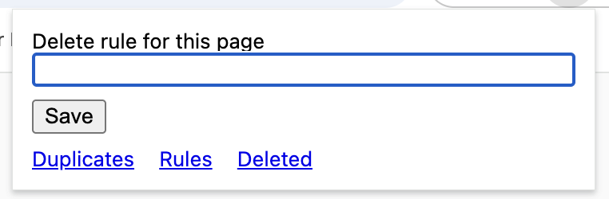
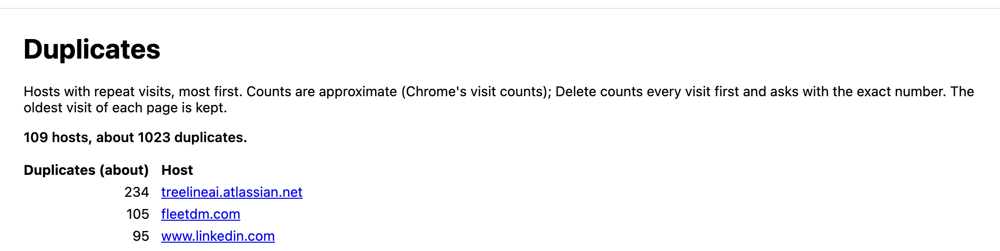
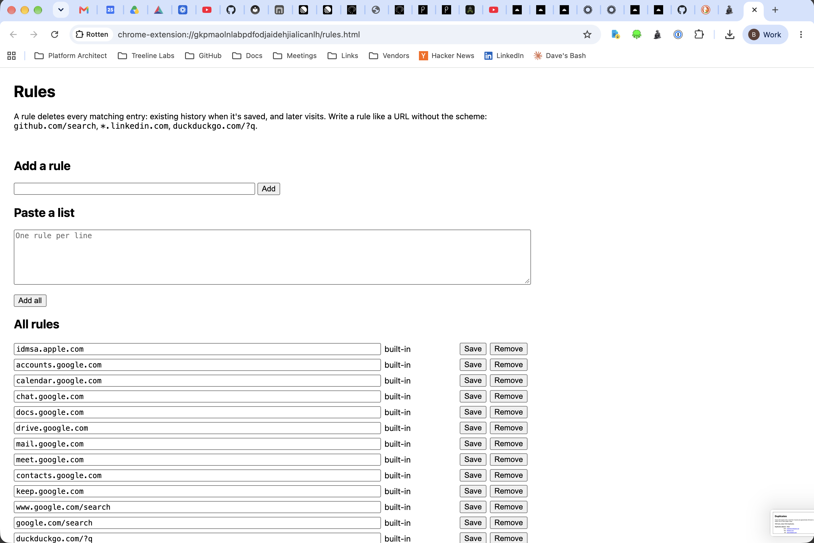
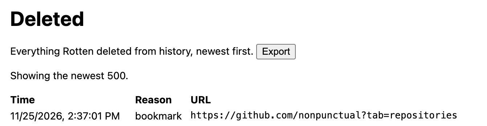

# Rotten


## Description

Rotten is a Google Chrome extension that keeps your browsing history from becoming rotten.

- **Duplicates:** allows 1-click deletion of every repeat visit to a page keeping the first vist.
- **Noise:** deletes entries that match: existing history when a rule is saved and later visits as they happen.
- **Bookmarks:** bookmarking a page deletes its history and later visits to it are deleted if it's visited again (uses exact URL match.)

Built-in rules:

| Rule | Deletes |
| --- | --- |
| Apple sign-in | Every page on `idmsa.apple.com`. |
| Google Apps | Every page on `accounts`, `calendar`, `chat`, `contacts`, `docs`, `drive`, `keep`, `mail`, and `meet.google.com`. |
| Google search | `google.com/search` and `www.google.com/search`. |
| DuckDuckGo | Searches (`duckduckgo.com/?q`) and ad clicks (`duckduckgo.com/y.js`). |
| GitHub | `github.com/search`, `/sessions`, `/settings`, and a repo's edit and compare pages (`github.com/*/*/edit`, `github.com/*/*/compare`). |
| LinkedIn | Every page on `linkedin.com` and its subdomains (`*.linkedin.com`). |
| Authentication strings | Any URL whose host or path contains `login`, `logout`, `oauth`, `oauth2`, `authorize`, `auth`, `signin`, `sign-in`, `sign-on`, or `sso` as a whole word (as `grep -w` defines one: letters, digits, and `_` are word characters).

Built-in rules are simply examples that are saved when Rotten is installed. All can be edited or removed. Add your own [Rules](#rules)!

Rotten also includes `archive.chrome.history.sh`: a standalone script that backs up your Chrome History to a local SQLite database. Archived rows are never removed so your history survives past Chrome's 90-day retention window.

```sh
./archive.chrome.history.sh --dry-run   # preview
./archive.chrome.history.sh
```

## Screenshots

<br>

<br>

<br>



## Pages

### First run

Installing Rotten opens the first-run page once. It counts the existing history matched by the built-in rules and by your bookmarks and one **Delete** button deletes it. Rules and bookmarks act on new visits from the install forward.

### Popup

Click the toolbar icon on a web page to make a rule for it. The field is prefilled with the page's host and path; a site's root page becomes the whole host. Edit it, **Save**, and confirm. The popup links to the Duplicates, Rules, and Deleted pages.

### Duplicates

Hosts with repeat visits, most first. Click a host to see its pages and their visit counts; **Make rule** opens the Rules page with that page filled in. **Delete duplicates** counts every visit, asks "Delete N entries from host?", and deletes every visit to each page except the oldest. Nothing is deleted automatically.

### Rules

Every rule, built-in and added, each editable and removable. Add one rule, or paste a list. See [Rules](#rules).

## Install

### From source

Load the unpacked extension in Google Chrome (requires Developer mode):

```sh
git clone https://github.com/nonpunctual/rotten.git
```

Then `chrome://extensions` → enable Developer mode → Load unpacked → select `extension/`. The manifest's `key` gives it the same extension ID as the signed build: `gkpmaolnlabpdfodjaidehjialicanlh`. After changing the code, reload it from its card on `chrome://extensions`.

### Package

The `.pkg` on the [latest release](https://github.com/nonpunctual/rotten/releases/latest) page is signed and notarized. It installs the signed `.crx`, `updates.xml`, and `rotten-policy.mobileconfig` to **`/Library/Application Support/Rotten`**.

The package only places files. To install the extension, open `rotten-policy.mobileconfig` and approve the profile in System Settings. The profile force-installs Rotten through Chrome policy (`ExtensionInstallForcelist`), so Developer mode isn't needed.

### Building

```sh
./repack.sh <version>
```

`repack.sh` sets the version in `extension/manifest.json`, packs `extension/` into `rotten-<version>.crx` signed with `rotten.pem`, writes `updates.xml` and `rotten-policy.mobileconfig` with the extension ID, and stages all three in `payload/Library/Application Support/Rotten/`. It needs Google Chrome in `/Applications` (or set `CHROME_BIN`).

`rotten.pem` isn't in the repo. Without it, `repack.sh` makes a new key, which means a new extension ID. Remove `key` from `extension/manifest.json` first, or `repack.sh` stops because the two IDs differ.
